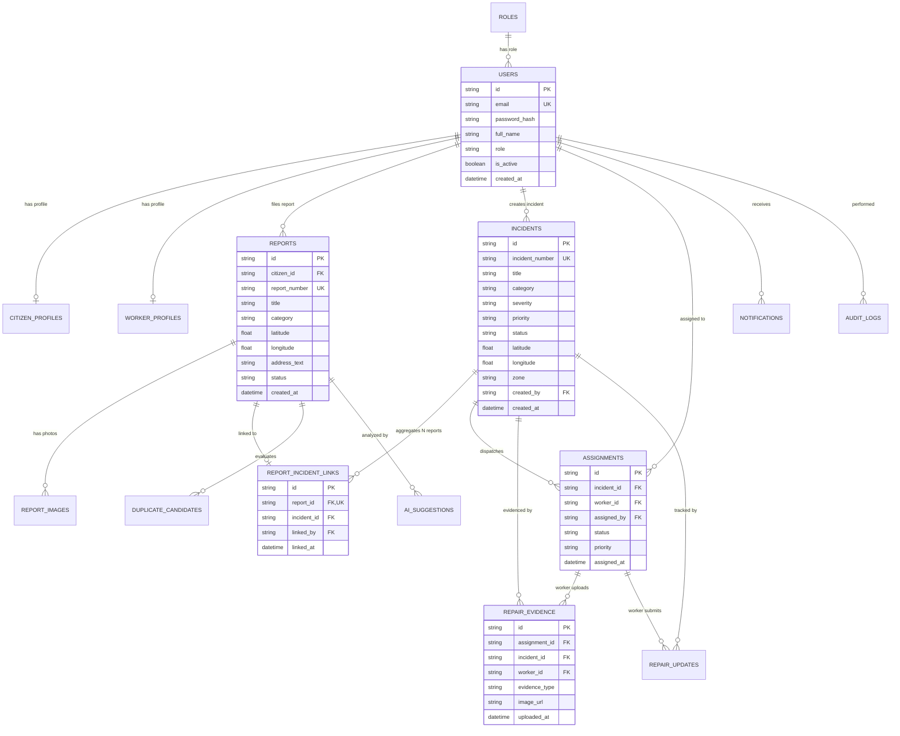

# WaterWatch PostgreSQL + PostGIS Database Schema Documentation

This document provides the complete reference for the WaterWatch database schema.

---

## 1. Quick File Links to the Schema in the Codebase

You can view the full schema across these primary locations in the repository:

1. **Pure SQL DDL File (PostgreSQL & PostGIS)**:
   - [backend/schema.sql](file:///c:/Users/mahim/Downloads/waterWatch-backend/backend/schema.sql) — Contains all 16 `CREATE TABLE`, foreign key constraints, indexes, and PostGIS `GIST` spatial indexes.
2. **SQLAlchemy 2.0 ORM Models (Python Source of Truth)**:
   - [backend/app/models/](file:///c:/Users/mahim/Downloads/waterWatch-backend/backend/app/models/):
     - [user.py](file:///c:/Users/mahim/Downloads/waterWatch-backend/backend/app/models/user.py) (`users`, `roles`, `citizen_profiles`, `worker_profiles`)
     - [report.py](file:///c:/Users/mahim/Downloads/waterWatch-backend/backend/app/models/report.py) (`reports`, `report_images`, `duplicate_candidates`)
     - [incident.py](file:///c:/Users/mahim/Downloads/waterWatch-backend/backend/app/models/incident.py) (`incidents`, `report_incident_links`)
     - [assignment.py](file:///c:/Users/mahim/Downloads/waterWatch-backend/backend/app/models/assignment.py) (`assignments`, `repair_evidence`, `repair_updates`)
     - [ai.py](file:///c:/Users/mahim/Downloads/waterWatch-backend/backend/app/models/ai.py) (`ai_suggestions`)
     - [notification.py](file:///c:/Users/mahim/Downloads/waterWatch-backend/backend/app/models/notification.py) (`notifications`)
     - [audit.py](file:///c:/Users/mahim/Downloads/waterWatch-backend/backend/app/models/audit.py) (`status_history`, `audit_logs`)
3. **Database Configuration**:
   - [backend/app/database.py](file:///c:/Users/mahim/Downloads/waterWatch-backend/backend/app/database.py) — Engine initialization and session lifecycle.
   - [docker-compose.yml](file:///c:/Users/mahim/Downloads/waterWatch-backend/docker-compose.yml) — PostGIS container specification (`postgis/postgis:15-3.3`).

---

## 2. Entity-Relationship (ER) Diagram



---

## 3. Table Catalog & PostGIS Spatial Features

### 1. `reports` (Citizen Submissions)
- **Primary Key**: `id` (`VARCHAR(36)`)
- **Foreign Keys**: `citizen_id` $\rightarrow$ `users.id`
- **Spatial Columns**: `latitude` (`FLOAT`), `longitude` (`FLOAT`)
- **PostGIS Spatial Index**:
  ```sql
  CREATE INDEX idx_reports_geom ON reports USING GIST (
      ST_SetSRID(ST_MakePoint(longitude, latitude), 4326)
  );
  ```
- **Domain Purpose**: Stores raw citizen leak submissions. Multiple citizen reports in the same geographical area are clustered using PostGIS distance calculations (`ST_DWithin`).

### 2. `incidents` (Municipal Work Orders)
- **Primary Key**: `id` (`VARCHAR(36)`)
- **Foreign Keys**: `created_by` $\rightarrow$ `users.id`
- **Spatial Columns**: `latitude` (`FLOAT`), `longitude` (`FLOAT`), `zone` (`VARCHAR(100)`)
- **PostGIS Spatial Index**:
  ```sql
  CREATE INDEX idx_incidents_geom ON incidents USING GIST (
      ST_SetSRID(ST_MakePoint(longitude, latitude), 4326)
  );
  ```
- **Domain Purpose**: The official repair project authorized by the administrator. Multiple citizen reports link here via `report_incident_links`.

### 3. `report_incident_links` (Many-to-One Linkage)
- **Primary Key**: `id` (`VARCHAR(36)`)
- **Unique Constraint**: `report_id` (Ensures a report belongs to at most one incident).
- **Foreign Keys**: `report_id` $\rightarrow$ `reports.id`, `incident_id` $\rightarrow$ `incidents.id`, `linked_by` $\rightarrow$ `users.id`.
- **Domain Purpose**: Completely decouples citizen reports from municipal work orders, preventing the invalid "one-report = one-incident" assumption.

### 4. `worker_profiles`
- **Primary Key**: `id` (`VARCHAR(36)`)
- **Foreign Keys**: `user_id` $\rightarrow$ `users.id`
- **Spatial Columns**: `current_latitude` (`FLOAT`), `current_longitude` (`FLOAT`), `zone` (`VARCHAR(100)`)
- **Domain Purpose**: Enables smart dispatching based on worker proximity to incident coordinates.

### 5. `duplicate_candidates`
- **Primary Key**: `id` (`VARCHAR(36)`)
- **Foreign Keys**: `report_id` $\rightarrow$ `reports.id`, `potential_duplicate_report_id` $\rightarrow$ `reports.id`
- **Metrics**: `distance_meters`, `similarity_score`, `time_diff_hours`, `text_similarity`
- **Domain Purpose**: Stores AI and geospatial duplicate detection results for administrator review.

### 6. `repair_evidence`
- **Primary Key**: `id` (`VARCHAR(36)`)
- **Foreign Keys**: `assignment_id` $\rightarrow$ `assignments.id`, `incident_id` $\rightarrow$ `incidents.id`, `worker_id` $\rightarrow$ `users.id`
- **Fields**: `evidence_type` (`before`, `after`, `during`), `image_url`, `notes`, `materials_used`
- **Domain Purpose**: Stores photographic proofs uploaded by field workers prior to administrative approval.

---

## 4. How Anyone Can View and Query the Schema

### Option A: Open the SQL File in VS Code / Any Editor
Open [backend/schema.sql](file:///c:/Users/mahim/Downloads/waterWatch-backend/backend/schema.sql) directly to inspect the complete DDL statements, indexes, and relational integrity constraints.

### Option B: Using a Database Client (DBeaver, pgAdmin, TablePlus)
1. If running PostgreSQL via Docker:
   - **Host**: `localhost` (or `127.0.0.1`)
   - **Port**: `5432`
   - **Database**: `waterwatch_db`
   - **Username**: `waterwatch_user`
   - **Password**: `waterwatch_secure_password_2026`
2. You can view the visual ERD diagram directly inside DBeaver by expanding `waterwatch_db` $\rightarrow$ `Schemas` $\rightarrow$ `public` $\rightarrow$ `Diagrams`.

### Option C: Using the Command Line (`psql`)
Run this command from your terminal:
```bash
# List all 16 tables:
docker exec -it waterwatch_postgres psql -U waterwatch_user -d waterwatch_db -c "\dt"

# View structure, foreign keys, and indexes for any specific table (e.g. reports):
docker exec -it waterwatch_postgres psql -U waterwatch_user -d waterwatch_db -c "\d reports"
```

### Option D: Viewing Local SQLite Tables
In local development mode without Docker:
- Open `waterwatch.db` using **DB Browser for SQLite** or the **SQLite Viewer** VS Code extension to inspect tables and execute queries.

### Option E: FastAPI Interactive OpenAPI Documentation
1. Run the backend:
   ```bash
   python -m uvicorn app.main:app --app-dir backend --reload
   ```
2. Navigate to `http://127.0.0.1:8000/docs` in your browser.
3. Scroll to the bottom under **Schemas** to inspect all Pydantic and database entities, data types, and required fields.
